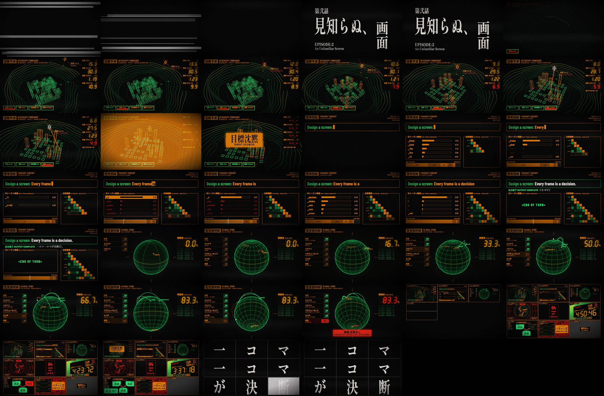
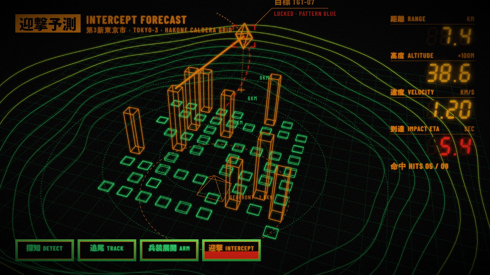
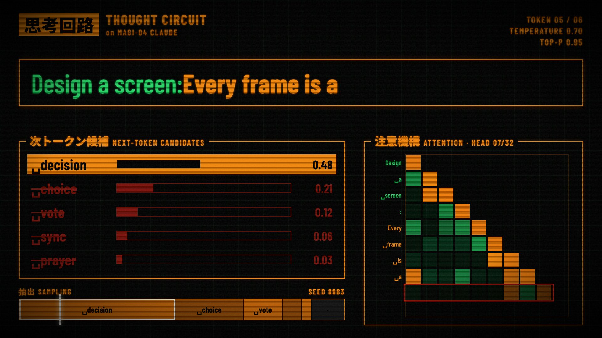
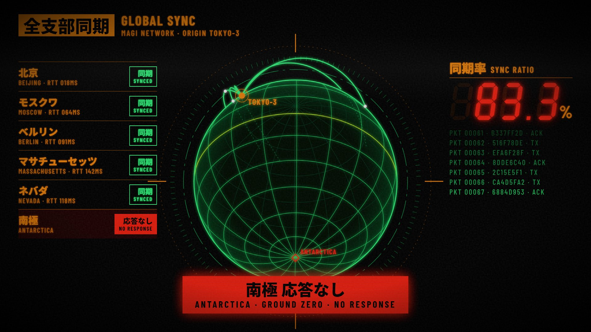
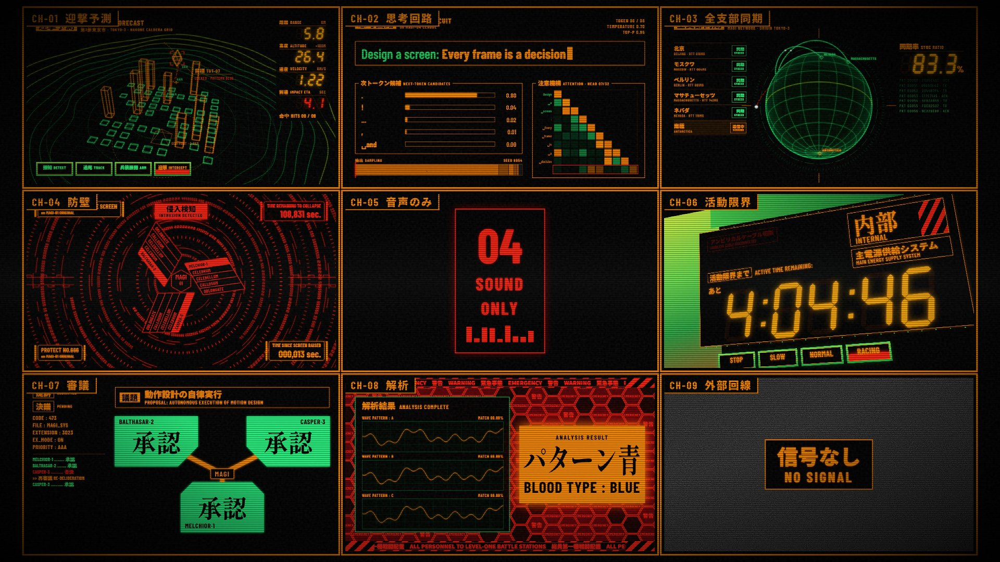
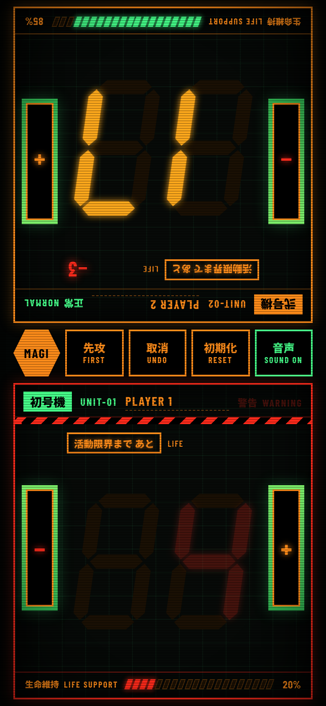

# EVA UI

Two short motion-graphics pieces in the style of the NERV / MAGI terminal
displays from *Neon Genesis Evangelion*, built with
[Remotion](https://www.remotion.dev/) (React components rendered frame by
frame to MP4). All the graphics and sound are code: SVG, CSS, fonts and
synthesized audio. There are no image, video or audio samples.

- **Episode 1, 第壱話「思考、起動」** ([`media/magi-sequence.mp4`](media/magi-sequence.mp4)):
  recreations of screens from the show.
- **Episode 2, 第弐話「見知らぬ、画面」 *An Unfamiliar Screen*** ([`media/unfamiliar-screen.mp4`](media/unfamiliar-screen.mp4)):
  new screens in the same design language, none of them from the show.

- **NERV Life Support** ([`tracker/`](tracker/)): a two-player Magic: The
  Gathering life tracker in the same design language. It's a real tool, not
  a video.

## Episode 1: MAGI Sequence


| # | Scene | What happens |
|---|-------|--------------|
| 1 | `TitleCard` | Stutter-cut Matisse-style kanji flashes, then the episode card 第壱話「思考、起動」 |
| 2 | `ActiveTime` | 外部 → umbilical cable severed → 内部. The seven-segment battery clock starts at 5:00:00, then the drive mode is thrown into RACING and the clock burns down fast |
| 3 | `MagiDefense` | Type-B defense screen. Glyph rings spin around the three MAGI cores, then an intrusion eats the rings from the outside in while the collapse timer drains |
| 4 | `MagiVote` | The MAGI deliberate on 議題「動作設計の自律実行」. Melchior and Balthasar approve, Casper dissents, wavers, and the motion carries 全会一致 |
| 5 | `PatternBlue` | Three waveforms converge on one signature → パターン青 / BLOOD TYPE: BLUE, and the EMERGENCY honeycomb floods the screen |
| 6 | `EndCard` | Staff card, 終劇, CRT power-off |

| | |
|---|---|
|  |  |
|  |  |

## Episode 2: An Unfamiliar Screen



The rules from episode 1 are kept: orange condensed labels, bilingual
JP/EN tags, seven-segment readouts, green-plate mode buttons, flicker-on
elements, hard cuts. The content is new. Each screen uses a different kind
of motion:

| # | Scene | What happens |
|---|-------|--------------|
| 1 | `TitleCardTwo` | 第弐話「見知らぬ、画面」, a riff on the show's episode 2 title 見知らぬ、天井 |
| 2 | `Tactical` | **迎撃予測 INTERCEPT FORECAST.** A 3D wireframe Tokyo-3 in the Hakone caldera, projected by hand into SVG. A target is tracked along a predicted path. The civilian blocks sink, the GeoFront shows through the ground, weapon buildings rise and fire in sequence → 目標沈黙 |
| 3 | `ThoughtCircuit` | **思考回路 THOUGHT CIRCUIT on MAGI-04 CLAUDE.** Next-token prediction as a NERV screen: candidate probability bars, a sampling needle spinning down onto the distribution, a causal attention map growing a row per token. It writes *"Every frame is a decision."* |
| 4 | `GlobalSync` | **全支部同期 GLOBAL SYNC.** A spinning wireframe globe. MAGI links to each branch over great-circle arcs and the sync ratio climbs. The view then tilts south: Antarctica, ground zero, doesn't answer |
| 5 | `MonitorWall` | Every screen from both episodes live on a 3×3 wall (plus SOUND ONLY and NO SIGNAL feeds). It cuts tile by tile into one title card, 一コマ一コマが決断 ("every frame is a decision"), then the tube switches off |

| | |
|---|---|
|  |  |
|  |  |

## NERV Life Support (MTG life tracker)



Lay the phone flat between the two players. Each half faces its player:
the far panel is rotated 180°, the same as the official MTG Companion
tracker.

- **Life.** Tap the left half to lose 1 and the right half to gain 1. Hold
  to repeat. Quick taps on one player fold into a single change, shown as a
  green or red delta beside the total and undone in one step.
- **Readout.** Amber seven-segment digits under 活動限界まで あと (the
  battery screen's "until activity limit, remaining"), with a 20-cell
  生命維持 LIFE SUPPORT gauge scaled to the starting life.
- **States.** At 5 or less the panel turns red, hazard stripes scroll and
  警告 WARNING blinks. At 0 a 活動停止 UNIT OFFLINE stamp comes down. You
  can still adjust life afterwards.
- **Console strip.** 先攻 FIRST runs a MAGI vote (Melchior, Balthasar and
  Casper vote, majority wins, sometimes one dissents) and stamps the first
  player's panel. 取消 UNDO. 初期化 RESET to 20, 30 or 40 (Commander).
  音声 SOUND toggles the effects.
- **Details.** Tap a player's name to rename it. Sound effects are
  synthesized live with Web Audio, using the same recipes as the videos.
  Taps vibrate on phones that support it. The page asks the screen to stay
  awake. The game survives a refresh (saved in the browser).

`tracker/life-tracker.html` is the source. `npm run tracker` wraps it into
the standalone `tracker/index.html`, which you can open directly or host
anywhere, e.g. GitHub Pages.

## Sound

Both episodes have a full sound design, and all of it is synthesized.
`scripts/make-sfx.mjs` builds every effect from oscillators, seeded noise and
one-pole filters and writes them to `public/sfx/`. There are no samples. The
palette:

| | |
|---|---|
| **UI** | `blip`, `blip-lo` (elements flickering on), `chatter` (MAGI data streams), `tick` (clock, token commits), `ratchet` (the sampling needle decelerating) |
| **Alerts** | `klaxon` (pulsed-square alarm), `glitch` (bit-crushed intrusion), `approve` / `deny` (MAGI votes), `ping` (lock-on, branch sync) |
| **Impacts** | `hit` (title-card cuts), `impact`, `boom`, `stamp` (verdict slams: a thump plus an inharmonic bell), `zap` (FM beam), `rumble` |
| **Tube** | `power-on`, `power-off`, `static` (signal tears on hard cuts) |
| **Beds** | `hum` (mains hum), `tension` (beating detuned saws) |

Each scene places its cues next to the visuals they belong to, so sound
and picture share the same frame numbers. Where the picture is driven by
data, the sound is derived from the same data. The battery clock ticks once
per displayed second, which turns into a rattle when RACING burns the clock
down. The zaps come from the same list of weapon buildings that draws the
beams. Casper's flip-flops fire whenever its vote changes. The monitor
wall mutes its tiles (`SfxGain`) and has a sound design of its own.

Beds are designed as seamless 4 s loops and tiled to 12 s at build time.
Remotion's `<Audio loop>` leaves a gap of about a frame at each wrap.

## Running it

```bash
npm install
npm run dev        # Remotion Studio: scrub the timeline, preview each scene on its own
npm run render     # episode 1, full quality → out/magi-sequence.mp4
npm run render:ep2 # episode 2 → out/unfamiliar-screen.mp4
npm run sfx        # re-synthesize public/sfx/*.wav
```

If you add Japanese text to a scene, run `npm run glyphs`. It updates the
glyph list in `src/fonts.ts`, so the CJK font subsets are loaded before any
frame renders.

Each scene is also registered as its own composition (`Scene-ActiveTime`,
`Scene-MagiDefense`, …), so you can preview or render scenes one at a time.

Remotion downloads its own headless Chrome the first time it renders. If you
already have one, you can point it there with
`--browser-executable=/path/to/chrome`.

## How it's put together

```
src/
  Root.tsx              scene list + compositions
  theme.ts              palette, fonts, glow helper
  fonts.ts              bundled fonts; blocks rendering until every glyph is loaded
  anim.ts               flicker-in, blink, decode-scramble, easing helpers
  components/
    CRT.tsx             scanlines, grain, hum bar, vignette, cut tears
    SevenSeg.tsx        hand-built SVG seven-segment display
    camera3d.ts         tiny perspective camera for SVG wireframes
    Sfx.tsx             <Sfx>, <SfxAt>, <Bed> cue helpers + mute context
scripts/
  make-sfx.mjs          sound-effect synthesizer
  sync-glyphs.mjs       CJK font preload list
  scenes/*.tsx          one file per scene
```

- **Deterministic.** Every bit of randomness (flicker, grain, glyph rings, hex
  timing) goes through Remotion's seeded `random()`, so a given frame always
  renders the same way.
- **Fonts.** Shippori Mincho B1 (800) stands in for Matisse EB on the title
  cards. Barlow Condensed and Noto Sans JP are used for the terminal labels.
  All three are bundled through Fontsource, so nothing is fetched at render
  time.
- **Glow.** SVG `feGaussianBlur` + `feMerge` bloom on vector layers and
  layered `text-shadow` on HTML text. The MAGI rings are drawn once into a
  mask and filled through it. That lets a single gradient go green→red down
  the screen, and a clip-path annulus tracks the intrusion front.

A fan homage; *Evangelion* and its designs belong to khara / GAINAX.
