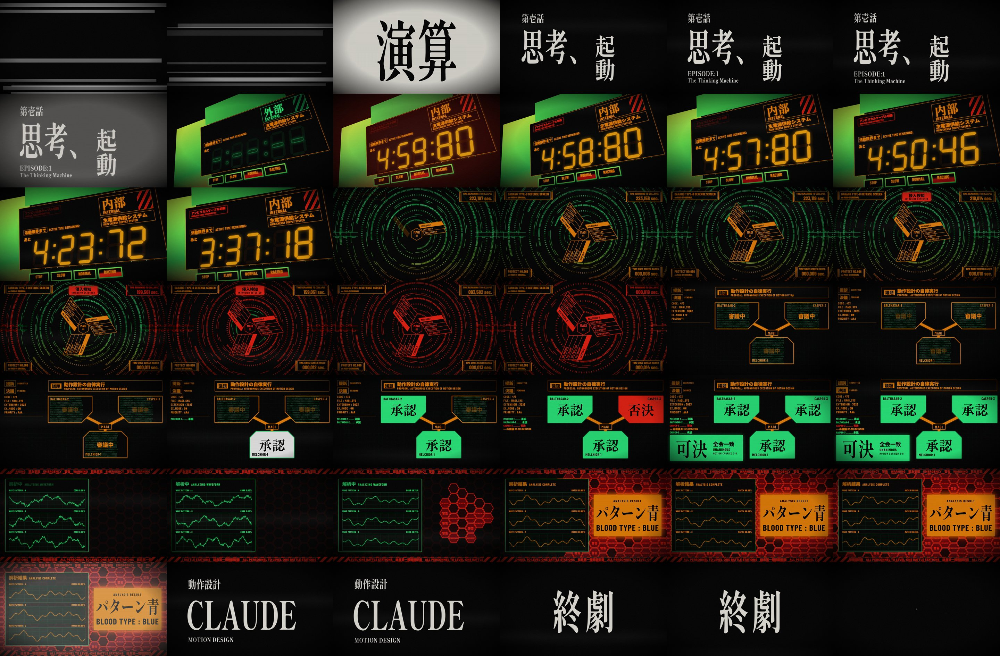
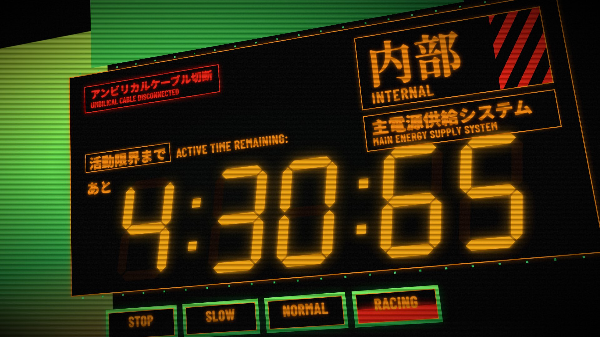
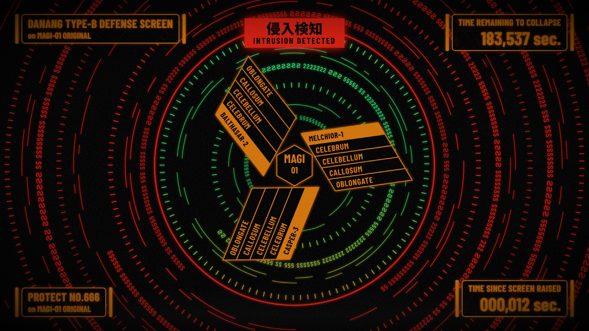
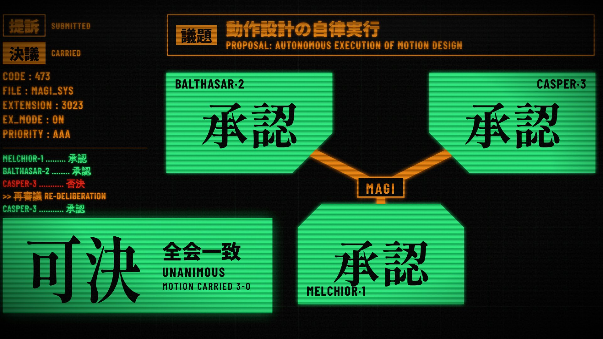
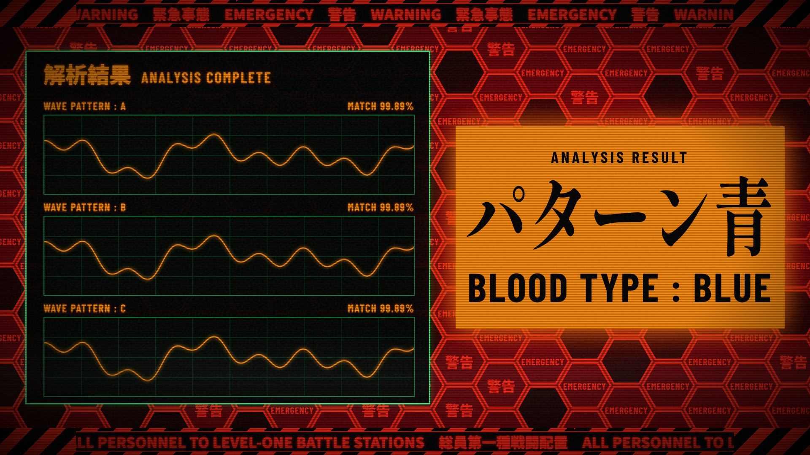

# EVA UI — MAGI Sequence

A 40-second motion-graphics piece in the style of the NERV / MAGI terminal
displays from *Neon Genesis Evangelion*. It's built with
[Remotion](https://www.remotion.dev/) (React components rendered frame by
frame to MP4). All the graphics are code: SVG, CSS and fonts. There are no
image or video assets.

**▶ Watch: [`media/magi-sequence.mp4`](media/magi-sequence.mp4)**



## The sequence

| # | Scene | What happens |
|---|-------|--------------|
| 1 | `TitleCard` | Stutter-cut Matisse-style kanji flashes, then the episode card 第壱話「思考、起動」 |
| 2 | `ActiveTime` | 外部 → umbilical cable severed → 内部. The seven-segment battery clock starts at 5:00:00, then the drive mode is thrown into RACING and the clock burns down fast |
| 3 | `MagiDefense` | Type-B defense screen. Glyph rings spin around the three MAGI cores, then an intrusion eats the rings from the outside in while the collapse timer drains |
| 4 | `MagiVote` | The MAGI deliberate on 議題「動作設計の自律実行」. Melchior and Balthasar approve, Casper dissents, wavers, and the motion carries 全会一致 |
| 5 | `PatternBlue` | Three waveforms converge on one signature → パターン青 / BLOOD TYPE: BLUE, and the EMERGENCY honeycomb floods the screen |
| 6 | `EndCard` | Staff card, 終劇, CRT power-off |

| | |
|---|---|
|  |  |
|  |  |

## Running it

```bash
npm install
npm run dev        # Remotion Studio: scrub the timeline, preview each scene on its own
npm run render     # full-quality render → out/magi-sequence.mp4
```

Each scene is also registered as its own composition (`Scene-ActiveTime`,
`Scene-MagiDefense`, …), so you can preview or render scenes one at a time.

Remotion downloads its own headless Chrome the first time it renders. If you
already have one, you can point it there with
`--browser-executable=/path/to/chrome`.

## How it's put together

```
src/
  Root.tsx              scene list + compositions
  theme.ts              palette, fonts, glow helper
  fonts.ts              bundled fonts; blocks rendering until every glyph is loaded
  anim.ts               flicker-in, blink, decode-scramble, easing helpers
  components/
    CRT.tsx             scanlines, grain, hum bar, vignette, cut tears
    SevenSeg.tsx        hand-built SVG seven-segment display
  scenes/*.tsx          one file per scene
```

- **Deterministic.** Every bit of randomness (flicker, grain, glyph rings, hex
  timing) goes through Remotion's seeded `random()`, so a given frame always
  renders the same way.
- **Fonts.** Shippori Mincho B1 (800) stands in for Matisse EB on the title
  cards. Barlow Condensed and Noto Sans JP are used for the terminal labels.
  All three are bundled through Fontsource, so nothing is fetched at render
  time.
- **Glow.** SVG `feGaussianBlur` + `feMerge` bloom on vector layers and
  layered `text-shadow` on HTML text. The MAGI rings are drawn once into a
  mask and filled through it. That lets a single gradient go green→red down
  the screen, and a clip-path annulus tracks the intrusion front.

A fan homage; *Evangelion* and its designs belong to khara / GAINAX.
